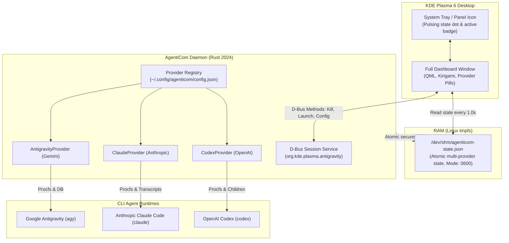

# AgentiCom: AI CLI Monitoring System for KDE Plasma 6

[](https://kde.org/plasma-desktop/)
[](https://www.qt.io/)
[](https://www.rust-lang.org/)
[](https://www.kernel.org/)
[](tests/)
[](docs/WALKTHROUGH.md)
[](LICENSE)

An ultra-responsive, modular, zero-overhead KDE Plasma 6 plasmoid and Linux procfs daemon for monitoring and controlling AI CLI coding agents:
* 🔵 **Google Antigravity CLI (`agy`)**
* 🟠 **Anthropic Claude Code (`claude`)**
* 🟢 **OpenAI Codex CLI (`codex`)**

---

## 📚 Documentation
* 📖 **[Comprehensive Technical Walkthrough](docs/WALKTHROUGH.md):** In-depth architecture, kernel security, IPC protocol, and testing strategy.
* 👤 **[Client & User Manual](docs/CLIENT_MANUAL.md):** User-friendly guide for daily usage, FAQ, and troubleshooting.

---

## 📸 Key Features & Architecture Highlights

- **⚡ Zero Idle Overhead:** Event-driven architecture powered by Linux kernel `inotify` and `/proc` polling. Consumes **0.00% CPU** when idle.
- **🛡️ Linux Kernel Security & Sandboxing:**
  - **Process Protection:** D-Bus and CLI `kill` commands verify target PIDs against active AI session whitelists and kernel UID (`/proc/{pid}/status`), preventing unauthorized signaling of system or user processes.
  - **Shared Memory Isolation:** Writes state to `/dev/shm/agenticom-state.json` strictly with POSIX mode `0600` and atomic `rename`, blocking local eavesdropping and symlink attacks.
  - **Shell Injection Immunity:** Direct vector execution for terminals (`konsole`, `kitty`, `alacritty`, `wezterm`, `xterm`) without `bash -c`, with path sanitization and conversation UUID whitelist validation.
- **🔌 Multi-Provider Modular Architecture:** Pluggable provider system (`AgentProvider` trait) configurable in `~/.config/agenticom/config.json`:
  - 🔵 **Google Antigravity Provider:** Native `agy` process tracking, Gemini 3.8 Flash, 5-hour quota reset tracking, and 45+ skill indexing.
  - 🟠 **Anthropic Claude Code Provider:** Native `claude` CLI process detection, Sonnet 3.7 / Opus 4.6 token tracking, project transcripts, and user prompt alerts.
  - 🟢 **OpenAI Codex Provider:** Native detection for Codex CLI sessions (`o3-mini`, `o1`, `gpt-4o`) with subprocess tracking.
- **🧠 Behavioral UX & CRO Optimization:**
  - **Hick's Law (Single Primary CTA):** Prominent primary action button for starting sessions, with isolated secondary stop actions.
  - **Fitts's Law (Touch-Friendly Hitboxes):** 34×34 px action buttons with protective spacing and 30 px filter pills.
  - **Peripheral Provider Recognition:** 3 px vertical color stripe on session cards matching each AI provider.
  - **Actionable Empty States:** Contextual CTAs tailored to active filters.
- **🚀 Sub-millisecond UI Latency:** Plasmoid reads state directly from Linux RAM tmpfs (`/dev/shm/agenticom-state.json`) with zero physical disk I/O.

---

## 🏛️ System Architecture



---

## 🚀 Installation & Quick Start

### Option 1: Quick Install (Prebuilt Binaries)

No Rust toolchain required! Simply download the release package:

```bash
# 1. Download and extract the latest release package
tar -xzf antigravity-plasma6-widget-v1.0.0-linux-x86_64.tar.gz
cd antigravity-plasma6-widget-v1.0.0-linux-x86_64

# 2. Run the installer
./install.sh
```

### Option 2: Build from Source

Requires `cargo` (Rust) and KDE Plasma 6 development tools:

```bash
# Clone the repository
git clone https://github.com/DavveCze/AgentiCom.git
cd AgentiCom

# Run the installer (compiles optimized binary)
./install.sh
```

### Selective Provider Installation:
You can choose which providers to enable during installation:
```bash
./install.sh --modules=antigravity,claude
```

---

## 🖥️ Usage & Desktop Integration

### Adding to KDE Plasma Panel
1. Right-click any empty space on your Plasma panel and select **Add Widgets...** (or press `Meta + T`).
2. Search for **AgentiCom: AI CLI Monitor**.
3. Drag the widget onto your panel or into the System Tray.

### Standalone Window Preview (For Testing)
```bash
plasmawindowed org.kde.plasma.antigravity
```

### Managing the Background Daemon
```bash
# Check service status
systemctl --user status agenticom-daemon.service

# View live daemon logs
journalctl --user -u agenticom-daemon.service -f

# Restart daemon
systemctl --user restart agenticom-daemon.service

# Dump current JSON state
agenticom-daemon dump
```

---

## 🧪 Comprehensive Verification

AgentiCom includes an automated test runner:

```bash
./test.sh
```

The test runner validates:
1. **Rust Unit & Integration Tests (35 Tests):** Process isolation, SQLite reader, quota parsing, multi-provider registry, kernel security guardrails, and settings synchronization.
2. **QML Syntax Validation (`qmllint`):** Strict verification of all QML files against Qt 6 standards.
3. **Plasma Package Verification (`kpackagetool6`):** Validates plasmoid registration.
4. **D-Bus Responsiveness:** Tests IPC calls against `org.kde.plasma.antigravity`.
5. **Systemd User Unit:** Verifies healthy background service execution.

---

## ⚙️ D-Bus API Reference

The daemon exposes an IPC interface on the session bus under `org.kde.plasma.antigravity` at `/org/kde/plasma/antigravity`:

| Method | Signature | Description |
| :--- | :--- | :--- |
| `get_state_json` | `() -> String` | Returns the complete serialized system state. |
| `get_active_count` | `() -> u32` | Returns the number of active AI sessions. |
| `kill_session` | `(u32 pid) -> bool` | Securely terminates a verified AI session with UID checks. |
| `launch_session` | `(String workspace) -> bool` | Launches a new terminal session in the given workspace. |
| `resume_session` | `(String conv_id, String workspace) -> bool` | Attaches terminal to an existing conversation. |
| `set_model` | `(String model) -> bool` | Updates the default AI model. |
| `set_effort` | `(String effort) -> bool` | Updates reasoning effort (`low`, `medium`, `high`, `max`). |
| `set_agent_mode` | `(String mode) -> bool` | Updates agent mode (`auto`, `accept-edits`, `plan`). |

---

## 📄 License

This project is licensed under the [MIT License](LICENSE).
Contributions, feedback, and pull requests are welcome!
