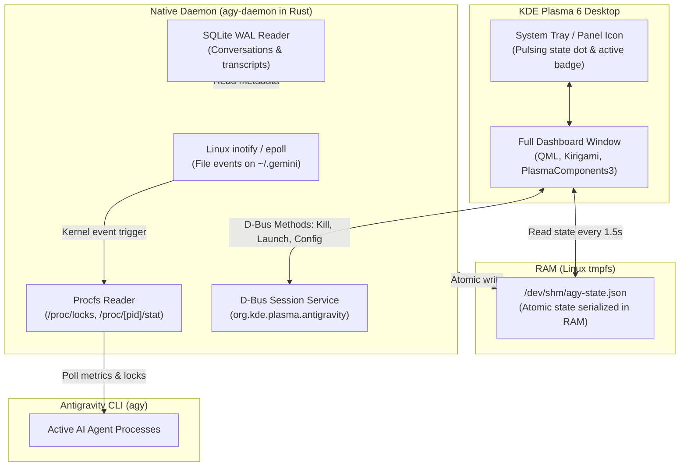

# Antigravity KDE Plasma 6 Agent Monitor & Widget

[](https://kde.org/plasma-desktop/)
[](https://www.qt.io/)
[](https://www.rust-lang.org/)
[](https://www.kernel.org/)
[](LICENSE)

An ultra-responsive, zero-overhead KDE Plasma 6 plasmoid and Linux procfs daemon for monitoring and controlling **Google Antigravity CLI (`agy`)** sessions, AI agents, model configurations, quotas, and extension skills.

---

## 📸 Highlights & Features

- **⚡ Zero Idle Overhead:** Event-driven architecture powered by Linux kernel `inotify` and `/proc/locks`. Consumes **0.00% CPU** when idle.
- **🚀 Sub-millisecond UI Latency:** Plasmoid reads state directly from Linux RAM tmpfs (`/dev/shm/agy-state.json`) with zero disk I/O.
- **🎯 Live Agent Supervision:**
  - Real-time CPU % and RSS memory tracking per agent.
  - Smart status detection: reliably distinguishes active code generation from waiting for user confirmation (`waiting_for_input`).
  - One-click Terminal Attach (`wezterm`, `kitty`, `alacritty`, `ghostty`, `konsole`).
  - Instant process termination (`SIGTERM` / `SIGKILL`).
- **📜 Conversation History:** Inspects session summaries and timestamps directly from SQLite WAL database.
- **⚙️ Model & Session Switching:**
  - Quick model selection: **Gemini 3.8 Flash**, **Claude Sonnet 4.6 (Thinking)**, **Claude Opus 4.6 (Thinking)**, **GPT-OSS 120B (Medium)**, and **Gemini 4 Argon**.
  - Thinking level tuning and agent execution mode switcher (`auto`, `accept-edits`, `plan`).
  - 5-hour quota reset tracking with smart notifications (only triggers when previous cycle reached >95% capacity).
- **🧰 Skill & Plugin Explorer:**
  - Automatically indexes 45+ builtin, user, and plugin skills.
  - Categorized filter pills with instant search.
  - One-click slash command copy (`/skill-name`), launch in terminal, or open `SKILL.md` in editor.

---

## 🏛️ System Architecture



---

## 🚀 Installation

### Option 1: Quick Install (Prebuilt Binaries)

No Rust toolchain required! Simply download the release package:

```bash
# 1. Download and extract the latest release package
tar -xzf antigravity-plasma6-widget-v1.0.0-linux-x86_64.tar.gz
cd antigravity-plasma6-widget-v1.0.0-linux-x86_64

# 2. Run the installer
./install.sh
```

### Option 2: Build from Source (Native CPU Optimization)

Requires `cargo` (Rust) and KDE Plasma 6 development tools:

```bash
# Clone the repository
git clone https://github.com/DavveCze/AGY-daemon-widget.git
cd AGY-daemon-widget

# Run the installer (compiles with -C target-cpu=native)
./install.sh
```

### What `install.sh` Does:
1. Installs `agy-daemon` into `~/.local/bin/agy-daemon`.
2. Installs the plasmoid into `~/.local/share/plasma/plasmoids/org.kde.plasma.antigravity`.
3. Registers the application icon in `~/.local/share/icons/hicolor/scalable/apps/antigravity.svg`.
4. Creates and activates the systemd user service `agy-daemon.service`.
5. Verifies `/dev/shm/agy-state.json` activation.

---

## 🖥️ Usage & Adding to Panel

### Adding to KDE Plasma Panel
1. Right-click any empty space on your Plasma panel and select **Add Widgets...** (or press `Meta + T`).
2. Type **Antigravity** into the search bar.
3. Drag **Antigravity Agent Monitor** onto your panel or into the System Tray.

### Standalone Window Preview (For Testing)
You can open the widget directly in a floating window without adding it to the panel:
```bash
plasmawindowed org.kde.plasma.antigravity
```

### Managing the Background Daemon
```bash
# Check service status
systemctl --user status agy-daemon.service

# View live daemon logs
journalctl --user -u agy-daemon.service -f

# Restart daemon
systemctl --user restart agy-daemon.service

# Print current state JSON directly
agy-daemon dump
```

---

## 📂 Repository Structure

```
AGY-daemon-widget/
├── daemon/                     # High-performance Rust daemon
│   ├── Cargo.toml
│   ├── src/
│   │   ├── main.rs             # CLI entrypoint & service loop
│   │   ├── proc_monitor.rs     # /proc/[pid]/stat & /proc/locks reader
│   │   ├── db_reader.rs        # SQLite WAL reader for conversations
│   │   ├── dbus_service.rs     # org.kde.plasma.antigravity D-Bus interface
│   │   ├── settings_manager.rs # agy settings.json reader/writer
│   │   ├── quota.rs            # 5-hour quota calculator & limiter
│   │   ├── notifications.rs    # Smart desktop notifications (libnotify/D-Bus)
│   │   └── state.rs            # Data models & JSON serialization
│   └── tests/                  # Rust unit & integration tests
├── plasmoid/                   # KDE Plasma 6 Plasmoid
│   └── org.kde.plasma.antigravity/
│       ├── metadata.json       # Plasmoid metadata & Plasma 6 definition
│       └── contents/
│           ├── assets/         # SVG icons & branding
│           └── ui/
│               ├── main.qml                    # Root item & data synchronization
│               ├── CompactRepresentation.qml   # Panel icon, badge & pulsing dot
│               └── FullRepresentation.qml      # 4-tab interactive dashboard
├── systemd/
│   └── agy-daemon.service      # User systemd service unit
├── tests/
│   └── test_plasmoid.py        # Automated QML syntax & structure validator
├── install.sh                  # One-click installer & uninstaller
├── test.sh                     # Complete test suite runner (Rust + QML + D-Bus)
├── build-release.sh            # Release packager & binary stripper
├── README.md                   # Project documentation
└── LICENSE                     # MIT License
```

---

## 🛠️ Development & Customization Guide

### Hot-Reloading QML During Development
Because the plasmoid reads state via `/dev/shm/agy-state.json`, you can make changes to QML files and preview them instantly without restarting Plasma:
```bash
# Run standalone window
plasmawindowed org.kde.plasma.antigravity
```
Whenever you edit [FullRepresentation.qml](file:///home/david/Projekty/AGY_Widget/plasmoid/org.kde.plasma.antigravity/contents/ui/FullRepresentation.qml), simply close and re-run `plasmawindowed`.

### Running the Test Suite
The project includes a comprehensive automated test runner:
```bash
./test.sh
```
This script executes:
1. **Rust Unit & Integration Tests (10/10):** Validates procfs parsing, lock detection, quota calculations, settings manipulation, and state serialization.
2. **QML Syntax Validation (`qmllint`):** Verifies all QML files adhere to strict Qt 6 / KDE Plasma 6 standards.
3. **Plasma Package Verification (`kpackagetool6`):** Checks package registry validity.
4. **D-Bus Responsiveness:** Tests IPC calls against `org.kde.plasma.antigravity`.
5. **Systemd Unit Status:** Verifies the user service is running healthy.

### Packaging a New Release
To compile a stripped binary and generate distribution archives:
```bash
./build-release.sh
```
This generates:
- `dist/antigravity-plasma6-widget-vX.Y.Z-linux-x86_64.tar.gz` (Complete standalone bundle with prebuilt binary).
- `dist/org.kde.plasma.antigravity.plasmoid` (Plasma package archive).
- SHA256 checksum files for verification.

---

## ⚙️ D-Bus API Reference

The daemon exposes an IPC interface on the session bus under `org.kde.plasma.antigravity` at `/org/kde/plasma/antigravity`:

| Method | Signature | Description |
| :--- | :--- | :--- |
| `GetActiveAgentsCount` | `() -> (u32)` | Returns the number of active `agy` processes. |
| `KillAgent` | `(u32 pid, bool force) -> (bool)` | Sends `SIGTERM` (force=false) or `SIGKILL` (force=true) to PID. |
| `TriggerStateUpdate` | `() -> ()` | Forces an immediate scan and writes fresh state to shared memory. |
| `SetDefaultModel` | `(string model_id) -> (bool)` | Updates default model in `~/.gemini/antigravity-cli/settings.json`. |
| `SetAgentMode` | `(string mode) -> (bool)` | Changes agent mode (`auto`, `accept-edits`, `plan`). |

---

## ❓ FAQ & Troubleshooting

### Widget shows "No active sessions" even though `agy` is running
- Antigravity tracks active CLI sessions via file locks in `~/.gemini/antigravity-cli/presence/*.lock`. Verify that this folder exists.
- Run `agy-daemon dump` in your terminal to see raw state data detected by the daemon.

### How to uninstall cleanly?
Run the installer with the `--uninstall` flag:
```bash
./install.sh --uninstall
```
This will cleanly stop and remove the systemd service, plasmoid files, daemon binary, and shared memory files.

---

## 📄 License

This project is licensed under the [MIT License](LICENSE).
Feel free to contribute, open issues, or submit pull requests!
